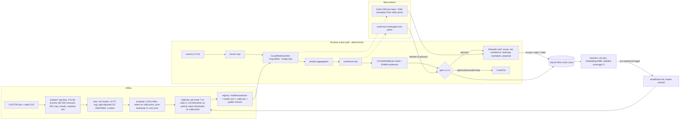

# Fine-tune before judging the cause model

The frozen-feature route is now ruled out. On complete data, across 5 leave-prints-out folds, frozen ImageNet ResNet18 features with linear heads score **below the majority floor**. A single 9-way head reaches top-1 **0.220 ± 0.032** against a floor of **0.254 ± 0.038** (−3.4 pp, K2 FAIL), and four per-parameter heads score **0.163 ± 0.025** (−9.0 pp, K2 FAIL) (SDP internal results). The cause model most likely to generalise to unseen CAXTON prints on a 4 GB laptop has to be one that **learns its features**. That means a fine-tuned backbone, started with LP-FT (fit the linear head first, then fine-tune), using augmentation matched to the domain, averaging predictions over a short window of frames, and selected and calibrated only on held-out calibration prints with print-level bootstrap intervals. The plan therefore puts experiments in a fixed order, each with its own go/no-go rule, instead of tuning in parallel. CAXTON's four per-parameter heads (flow, speed, z-offset, hotend × {low, good, high}) did not help as frozen linear heads. They remain worth testing **under fine-tuning**, because CAXTON's own multi-head gain was measured with end-to-end training. Explainability and proactiveness are built in, not added later, through four components: a class-discriminative Grad-CAM, example frames retrieved from other prints, a per-head CUSUM/HMM evidence accumulator that runs alongside the existing EWMA, and a conformal "trust alarm" that demotes the system to advisory when the camera stream drifts. The bar should be set honestly. CAXTON's **84.3%** comes from a **0.7/0.2/0.1 split that the paper never says is grouped by print**. Its public code splits individual images with `random_split` ([PMC](https://pmc.ncbi.nlm.nih.gov/articles/PMC9378646/); [caxton data_module.py](https://github.com/cam-cambridge/caxton/blob/main/src/data/data_module.py)). No held-out-print accuracy has ever been published for this dataset. K2 has now fired on complete data with frozen features. What happens next is the user's decision. The fine-tune on complete data, running tonight, is the decisive go/no-go experiment that the rest of this plan depends on.

Throughout, **[E]** marks a claim backed by a cited source, **[SDP]** marks our own measured results, and **[I]** marks inference or engineering estimates that still need measuring.

## A 0.43 → 0.21 cliff, not a weak signal, is the problem to solve

Our diagnostics rule out the cheap explanations [SDP]. Crops were verified correct on a crop sheet. Grayscale input gives the same balanced accuracy (0.207 vs 0.211), so the model is not riding filament colour. Plain and class-weighted CE give the same top-1. Dropping frames within 3–6 s of a setpoint change gains only **+1.2 pp top-1** (SDP internal results). What remains is the cross-print gap. A frozen ResNet18 linear probe on fold-0 calibration prints reaches top-1 0.374 against a floor of 0.178, and balanced accuracy 0.211 against chance 0.111. The same probe on a random-image split inside training prints reaches balanced accuracy 0.43. Per-print appearance (geometry, layer texture, lighting) dominates what the network learns. That probe was trained on only ~3,100 images. The complete-data run below answers the question it left open, and the answer is negative.

The complete-data frozen-feature results settle what generic features can do (SDP internal results). The setup was frozen ImageNet ResNet18 features in eval mode with no augmentation, linear heads, and weight decay chosen by NLL on calibration prints. The run covered 5 leave-prints-out folds, 163 test prints and 39,231 single-cause test images. The 9-way head scores top-1 **0.220** (95% CI 0.190–0.254), top-3 **0.506** against a floor top-3 of 0.596, balanced accuracy **0.194** against chance 0.111, and ECE 0.088. Per-cause recall shows where it fails: none 0.52, flow_high 0.29, z_offset_low 0.19, flow_low 0.16, speed_low 0.15, nozzle_temp_low 0.14, z_offset_high 0.11, nozzle_temp_high 0.11, speed_high 0.07. The majority cause, z_offset_high, is recalled only 11% of the time, which is why the top-1 falls below the floor. The weight decay chosen on calibration prints sat at the top of the 1e-4 to 1e-1 grid in several folds. [I] That points to a model fitting per-print appearance, where more regularisation, or features that carry less print identity, should help. Our reading [I] is that **generic ImageNet features with a linear readout do not separate process causes across unseen prints**. If the signal can be learned, the cross-print accuracy has to come from adapting the features: fine-tuning, augmentation matched to the domain, temporal aggregation, LP-FT or self-supervised backbones, all selected on whole held-out prints. This reading is consistent with the balanced accuracy staying above chance: the cause signal exists, but it is weak and entangled with print identity.

CAXTON's authors document the same mechanisms without measuring the gap. They warn that "there may be certain combinations of parameters which only appear in during a specific print or with a single colour of filament, and thus the network has learned these incorrect features as mappings" ([PMC](https://pmc.ncbi.nlm.nih.gov/articles/PMC9378646/)). Each of their eight CR-20 Pro printers used a different filament colour, which ties colour to printer ([PMC](https://pmc.ncbi.nlm.nih.gov/articles/PMC9378646/)). The dataset README names further drift sources: lighting, lateral head speed, and Z calibration that "tends to drift during repeated use" ([DATASET_README](https://github.com/cam-cambridge/caxton/blob/main/DATASET_README.md)). The paper's evidence of generalisation is qualitative. It shows correction demos on a rotated camera, four unseen thermoplastics, a Lulzbot Taz 6, and syringe-extruded PDMS and condiments. The 3D-part comparisons are 1 vs 1 (rook) and 3 vs 3 (spanners), and no success rate or time-to-correct is given ([PMC](https://pmc.ncbi.nlm.nih.gov/articles/PMC9378646/)). The 84.3% figure is itself roughly the mean of four head accuracies: flow 87.1%, speed 86.4%, Z 85.5%, hotend 78.3%. It is not an exact-match accuracy over 81 combinations, and it was measured after the 15 post-change frames had been filtered out ([PMC](https://pmc.ncbi.nlm.nih.gov/articles/PMC9378646/)). [I] Near-duplicate neighbouring frames, about 0.4 s apart within 150-frame constant-parameter blocks, almost certainly sit on both sides of that split. Our own leaky control (0.43 vs 0.21) shows how much a split like that inflates results.

The group's later work suggests they also do not treat zero-shot cross-part classification as solved. Fast-CAXTON narrowed the target to continuous **flow regression with a RegNet on >250k images at ~15 Hz** ([DOAJ](https://doaj.org/article/9bd52b3579b64e408bd7a29de2e5454c); [fast-caxton](https://github.com/cam-cambridge/fast-caxton)). The 2024 Iterative Learning paper couples a "foundation" extrusion model with **uncertainty awareness and active learning that improves over repeated builds of the same part** ([matta.ai summary](https://matta.ai/research-publications/iterative-learning-for-mass-production)). The general domain-generalisation literature gives the same message more bluntly. On DomainBed, **no algorithm beats carefully tuned ERM by more than about 1 point** under equal conditions, and model selection is part of the method ([Gulrajani & Lopez-Paz](https://arxiv.org/pdf/2007.01434)). On WILDS Camelyon17, ERM (70.3) beat IRM (64.2), CORAL (59.5) and GroupDRO (68.4) ([LISA table](https://arxiv.org/pdf/2201.00299)). The levers that do move out-of-distribution accuracy are more and better-labelled data, better pretrained features used gently, weight averaging, and honest selection. These shape the plan.

## Four heads lost 9 pp when frozen, so test them fine-tuned

Before the frozen results came in, the label formulation looked like the most consequential change. CAXTON uses one shared backbone with **four separate 3-way heads and a summed cross-entropy loss** ([PMC](https://pmc.ncbi.nlm.nih.gov/articles/PMC9378646/); [network_module.py](https://github.com/cam-cambridge/caxton/blob/main/src/model/network_module.py)). A frame with flow high and z-offset low then supervises both heads instead of being discarded. Our 9-way single-cause softmax throws away about 93% of the labelled frames [SDP] and imposes mutual exclusivity the data does not have. The paper's own multi-head evidence is thin but points the same way: a ResNet18 single-head flow model scored 77.5% against 82.1% for the multi-head version, a result the authors flag as needing more experiments ([PMC](https://pmc.ncbi.nlm.nih.gov/articles/PMC9378646/)). [I] No published ablation isolates single-label against multi-head training on held-out prints. Any gain from the extra data was always an inference, and the frozen test below came out against it.

The multi-head model can still feed the existing 9-way interface without touching the conformal, gate or counterfactual code. Under a conditional-independence assumption across heads, P(only parameter k is off, in direction d) ∝ p_k(d)·Π_{j≠k} p_j(good), and P(none) = Π_j p_j(good). Renormalise over the nine states, optionally plus a "multi" bucket [I]. Check the calibration of this product on held-out prints before relying on it. `CauseModel.predict(crop, defect)` keeps its image-only signature (ADR-0002). If the 9-way probability vector stays the output contract, `xqi/types.py` does not change. Exposing per-head posteriors to the card would be a type change, which needs a `SCHEMA_VERSION` bump and a logged DESCEND. Because the headline model metric changes with it, the user should approve that DESCEND before it is built.

The frozen-feature comparison is now done, and the 4-head formulation lost (SDP internal results). Trained on all rows including multi-deviation frames, with class weighting per head and cause probabilities taken as the renormalised joint of the single-deviation outcomes, it scored top-1 **0.163 ± 0.025** (95% CI 0.140–0.193). That is 9.0 pp below the floor and 5.7 pp below the 9-way head, with balanced accuracy 0.163 against 0.194 for the 9-way head. Its ECE was lower (0.046 against 0.088), which is expected for a model whose outputs sit close to uniform. Per head, on all test rows, accuracy was flow 0.415, speed 0.410, z-offset 0.382 and hotend 0.407. Every head is below its majority-class baseline (0.491, 0.509, 0.548 and 0.747). Class weighting trades raw accuracy for balance, and the hotend head is the clearest case, because "good" dominates it. [I] Two further mechanisms plausibly hurt the derived 9-way score. The product of four weak heads compounds their errors. And the independence assumption is wrong where causes look alike: high z-offset and low flow both show as under-extrusion, as CAXTON's authors note ([PMC](https://pmc.ncbi.nlm.nih.gov/articles/PMC9378646/)).

The comparison does not refute the multi-head idea. It refutes multi-head *with a frozen generic backbone and a linear readout*. CAXTON's multi-head advantage (82.1% against 77.5% for flow) came from **end-to-end training, on a split that was probably random-image** ([PMC](https://pmc.ncbi.nlm.nih.gov/articles/PMC9378646/)). The mechanism it relies on is that multi-deviation frames reshape the *shared features*, which a frozen backbone cannot do. The plan therefore keeps the 9-way head as the default and baseline, and tests the 4-head formulation as a **fine-tuned** variant against the same fine-tuned 9-way model. It is adopted only if it wins on the pre-registered rule. The rule is unchanged, and the frozen comparison shows it working as intended. Score both candidates on the same single-deviation and "none" frames from **calibration prints only**, with derived 9-way **balanced accuracy** as the primary metric and top-1 against the fold floor as secondary, both with 95% intervals from **resampling prints, not frames**. Adopt the 4-head model only if its gain's interval excludes zero. Balanced accuracy stays co-primary because, as these results show, a model can lose on top-1 to the always-majority floor while still carrying real signal (0.194 against 0.111). Balanced error is also the quantity that logit adjustment provably targets ([Menon et al.](https://arxiv.org/abs/2007.07314)). NFR-005 also requires top-3 ≥ 0.90 (reports/cause_eval_single_cached.md). Neither frozen model comes close (0.506 and 0.425), so that requirement should be reviewed together with S1 if the fine-tune also falls short.

Three cheap data-hygiene changes come with this, all with CAXTON precedent. First, normalise with **dataset statistics rather than ImageNet's**: CAXTON uses means of roughly [0.292, 0.270, 0.144] ([data_module.py](https://github.com/cam-cambridge/caxton/blob/main/src/data/data_module.py)). Second, use CAXTON's augmentations: ±10° rotation, perspective with p=0.1, crop scale 0.9–1.0, horizontal flip, and ±10% colour jitter ([PMC](https://pmc.ncbi.nlm.nih.gov/articles/PMC9378646/)). [I] Widening the hue jitter to cover filament colour is cheap, but grayscale already matched colour, so do not expect much from it. Avoid aggressive scale augmentation, because bead width relative to the nozzle *is* the flow signal. Third, take the label-lag window from the paper's physics: "changes are predominantly visible within 6 s" and CAXTON drops 15 frames ([PMC](https://pmc.ncbi.nlm.nih.gov/articles/PMC9378646/)). Our sweep found 3–6 s optimal and 10 s harmful [SDP]. [I] The hotend probably deserves a longer per-parameter window than flow, which would fit its being CAXTON's weakest head at 78.3%. Also drop z-offset labels below 0.08 mm, which the dataset authors call mislabelled, and prints 183–191 ([DATASET_README](https://github.com/cam-cambridge/caxton/blob/main/DATASET_README.md)). Replace class-weighted CE with **logit-adjusted CE**, which is Fisher-consistent for balanced error and costs nothing ([Menon et al.](https://arxiv.org/abs/2007.07314)).

## Backbone and training: probe first, fine-tune gently, average weights

Two backbone findings fit a 4 GB budget. Across ten distribution-shift benchmarks, full fine-tuning gained about 2% in-distribution but **lost about 7% out-of-distribution** against linear probing. **LP-FT** (fit the linear head first, then fine-tune) gave about +10% OOD over plain fine-tuning ([Kumar et al.](https://arxiv.org/abs/2202.10054)). Our earlier fold-0 runs on incomplete data had the probe ahead of a plain fine-tune (0.297 against 0.249 top-1 on T-0012 test) [SDP]. The complete-data frozen probe now sits below the floor, though, so a frozen probe is not the answer either. [I] LP-FT is the natural middle path: it starts from the probe's head and lets the features move only as far as the data demands. Combined with the high weight decay the calibration prints chose, it targets exactly the print-identity overfitting the frozen results point to. Second, DINOv2 ViT-S/14 (~21M parameters) has frozen features that transfer to out-of-domain imagery such as medical and geological images ([Oquab et al.](https://arxiv.org/pdf/2304.07193); [arXiv 2312.02366](https://arxiv.org/pdf/2312.02366v3); [arXiv 2407.18100](https://arxiv.org/pdf/2407.18100)). Use the **register variants**: plain DINOv2 emits high-norm artefact tokens in background patches that spoil attention maps ([Darcet et al.](https://ar5iv.labs.arxiv.org/html/2309.16588)). No paper applies DINOv2 to FFF nozzle images. The failure of frozen ImageNet features also lowers the prior that *any* frozen generic backbone will be enough [I]. Treat a frozen DINOv2 probe as a cheap screen, and expect DINOv2 to matter, if at all, as an LP-FT starting point. Cache embeddings once (80k × 384 float16 is about 61 MB) and train the heads on CPU in minutes [I].

On training, the most reliable DG gain in the literature is weight averaging. SWAD reports about +3.6 points over ERM on DomainBed ([SWAD](https://proceedings.neurips.cc/paper/2021/hash/bcb41ccdc4363c6848a1d760f26c28a0-Abstract.html)). An ensemble of moving averages gains about 4 points with ResNet-50 and also makes model selection more reliable ([EoA](https://proceedings.neurips.cc/paper_files/paper/2022/hash/372cb7805eaccb2b7eed641271a30eec-Abstract.html)). In PyTorch this is `torch.optim.swa_utils.AveragedModel`, one extra weight copy (~45 MB for ResNet18) [I]. MixStyle targets per-domain "style" in shallow layers ([Zhou et al.](https://arxiv.org/abs/2104.02008v1)), and here the domain is the print. It is the DG method best aligned with our failure mode, but its gain over tuned ERM is unproven, so it belongs in the second wave. Methods to deprioritise, with reasons: GroupDRO, IRM, CORAL and DANN, which usually give ≤1 point and can hurt ([DomainBed](https://arxiv.org/pdf/2007.01434); [LISA](https://arxiv.org/pdf/2201.00299)). TENT-style test-time adaptation and per-batch BN re-estimation, because TTA collapses under small batches and non-i.i.d., label-shifted streams ([SAR](https://tanmingkui.github.io/files/publications/Towards_Stable.pdf); [TTAB](https://github.com/LINs-lab/ttab)), and a print stream is 12 s blocks of one label. Video networks, because no FFF ablation shows temporal input beating aggregated single frames. If temporal modelling is wanted later, TSM adds it to a 2D ResNet at zero extra FLOPs ([Lin et al.](https://arxiv.org/abs/1811.08383v1)), though its data movement is not free ([arXiv 2109.13227](https://arxiv.org/pdf/2109.13227)).

The cheapest likely win of all is **temporal aggregation at inference**: average per-head log-probabilities over a short causal window inside one setpoint segment. It needs no new model and stays image-only [I]. CAXTON's controller does a version of this. It keeps a list of the last L predictions per parameter, acts only when one class reaches a mode fraction θ_mode, scales the step by that fraction, and waits for the printer's acknowledgement before predicting again to stop oscillation ([PMC](https://pmc.ncbi.nlm.nih.gov/articles/PMC9378646/)). The numeric L and θ_mode values sit in an unread figure image. [I] Aggregation removes frame noise but not print-level bias, so its gain on unseen prints will be smaller than on seen prints. It must be measured, and frame-level and window-level metrics reported side by side. This matters for S2: a model with balanced accuracy near 0.2 will produce large LAC sets at α=0.10, and window-level probabilities are the most direct way to shrink them.

## Explanation, uncertainty and early warning become first-class outputs

**Explanation.** EigenCAM takes the first principal component of activations with **no class discrimination** ([grad-cam PyPI](https://pypi.org/project/grad-cam/1.3.3/)). On a card that names a specific cause, "flow high" and "z-offset low" would get the same map. Switch to Grad-CAM or EigenGradCAM with a per-head, per-class target. Guided backprop, which CAXTON used ([PMC](https://pmc.ncbi.nlm.nih.gov/articles/PMC9378646/)), fails the Adebayo randomisation sanity checks and behaves like an edge detector ([Adebayo et al.](https://arxiv.org/pdf/1810.03292v2)), so do not copy it. Accept a heatmap method only after two checks. In cascading layer randomisation, the maps' rank correlation must collapse. On calibration prints, the method must beat a random map on ROAD MoRF/LeRF, which pytorch-grad-cam ships ([ROAD](https://proceedings.mlr.press/v162/rong22a.html)). Treat ROAD as one signal, not the arbiter ([Song et al.](https://arxiv.org/pdf/2304.13836v1)). [I] Bead width, gloss and z-squash are texture spread over the whole crop, and layer4 at 224 px gives a 7×7 map, so diffuse heatmaps are often the *correct* answer. Render layer3 (14×14) as well, and say so in the UI copy. CAXTON found the last layers attend to "the most recent extrusion… irrespective of parameter or target class" ([PMC](https://pmc.ncbi.nlm.nih.gov/articles/PMC9378646/)), which supports that caveat. Add **case-based evidence**: the k nearest labelled calibration or training frames in penultimate-feature space, retrieved from *other prints only*. Prototype networks roughly doubled human interpretation time in HIVE (about 13.6 min against 6.9 min for Grad-CAM) ([HIVE supp.](https://www.ecva.net/papers/eccv_2022/papers_ECCV/papers/136720277-supp.pdf)), and many learned prototypes are judged uninterpretable ([Sinhamahapatra et al.](https://arxiv.org/abs/2211.12173v1)). The human-factors evidence cuts both ways. Siemens workers given heatmaps improved inspection by **+7.7 pp (95% CI 3.3–12.0)**, by overruling wrong AI more often ([Senoner et al.](https://arxiv.org/pdf/2406.08271)). Bansal et al. found explanations raise acceptance **regardless of correctness**, and added nothing over showing confidence ([Bansal et al.](https://arxiv.org/abs/2006.14779v2)). The card must therefore always show calibrated confidence and the conformal set next to the map, with "abstain" visible.

**Uncertainty.** Keep split-conformal, but fix its unit of exchangeability. Frames within a print are autocorrelated, so calibrate on whole held-out prints and report coverage per print and the worst group [I]. With a multi-head model there are two routes. Calibrate the derived 9-way vector exactly as today, which needs no interface change. Or form four per-head 3-class sets, using Bonferroni α/4 if the card claims joint coverage. Fit temperature per head on one half of the calibration prints and the conformal quantile on the other half. Temperature scaling is the best single-parameter calibrator ([Guo et al.](https://arxiv.org/pdf/1706.04599)), but it **can enlarge adaptive conformal sets** ([arXiv 2402.04344](https://arxiv.org/pdf/2402.04344); [Dabah & Tirer](https://arxiv.org/html/2402.05806v4)). "Good" dominates, so use Mondrian per-class quantiles where each class has enough calibration frames from several prints, and **clustered conformal** where it does not ([Ding et al.](https://arxiv.org/abs/2306.09335)). If the model becomes a multi-label sigmoid instead, **Conformal Risk Control** bounds the false-negative rate over active causes ([Angelopoulos et al.](https://arxiv.org/abs/2208.02814)). Gate rule [I]: propose a change on head k only when its set is a singleton excluding "good". An empty set, or one containing both low and high, means abstain. When several heads are actionable, propose one change at a time in a fixed priority order, then wait a settling window. This mirrors CAXTON's acknowledgement wait ([PMC](https://pmc.ncbi.nlm.nih.gov/articles/PMC9378646/)) and makes S6 (direction ≥0.85) a direct read of the head's ordinal output.

**Proactive early warning.** EWMA + hysteresis is a smoothed version of evidence accumulation without its optimality. Replace or shadow it with a per-head **one-sided CUSUM** on the calibrated log-likelihood ratio log(p̂_k(off)/p̂_k(good)). Alternatively use a 3-state sticky **HMM forward filter** with the softmax as emission, which gives a posterior to display [I]. Add a second, separate alarm: a **conformal test martingale** on subsampled conformal p-values. By Ville's inequality its false-alarm probability is bounded by δ under exchangeability, and it signals that the input stream no longer looks like calibration data (new filament, lighting, camera bump), which should **demote the loop to advisory** ([Vovk 2021](https://projecteuclid.org/journals/statistical-science/volume-36/issue-4/Testing-Randomness-Online/10.1214/20-STS817.pdf); [Vovk et al., "Retrain or not retrain"](https://arxiv.org/pdf/2102.10439.pdf)). BOCPD's run-length posterior can show "change began ~12 s ago" ([Adams & MacKay](https://arxiv.org/pdf/0710.3742)). Be honest about "before visible". With image-only input, the system can warn earlier than a *human* notices by accumulating weak evidence, not before the physics reaches the bead [I]. CAXTON's 6 s visibility lag ([PMC](https://pmc.ncbi.nlm.nih.gov/articles/PMC9378646/)) leaves about 4 s, or roughly 10 frames at 2.5 Hz, inside S5's 10 s median budget. That makes S5 a tight but physically plausible target for flow and speed, and probably unreachable for the hotend. No FFF paper reports detection delay or false alarms per hour for image-based cause monitoring, so our S5 numbers will be first-of-kind.

## The build plan, phased and costed

Every step obeys four constraints. Selection, temperature, α, lag window and alarm thresholds are tuned **on calibration prints only**. `data/splits/logo.json` is never edited. Test folds are scored once, after a selection rule has been committed. GPU steps get the CPU smoke run plus a `docs/gpu-runs/` runbook first. VRAM and time figures are engineering estimates [I] unless marked, and confirming them with `torch.cuda.max_memory_allocated()` and timed runs is part of each step.

**Go/no-go order.** The frozen results turn the plan into a sequence of gates rather than a menu. Each gate is judged on calibration prints, except G1, which is the K2 check on test folds.

- **G1, tonight's 9-way fine-tune on complete data.** If it does not clear the floor with a print-bootstrap interval, together with balanced accuracy clearly above 0.194, image-only cross-print cause classification at this scale is in serious doubt. The user then decides on a pivot or a DESCEND.
- **G2, if G1 shows signal.** Add the cheapest multipliers before anything new: window aggregation (step 3), lag and loss hygiene (step 4), and LP-FT with weight averaging and stronger regularisation (step 7). Then test the fine-tuned 4-head variant.
- **G3, only if the ResNet18 recipe plateaus.** Try DINOv2 (step 6), fine-tuned rather than frozen.
- **Conformal, early warning and explanation tuning (steps 8–10).** These start only after a model has passed G1. Calibrating sets around a model below the floor would produce honest but useless 7–9-class sets and cannot meet S2.

### Today / this week (CPU-first, decisions and cheap wins)

| # | Build | Why (evidence) | Expected effect | Cost | Evaluated by |
|---|---|---|---|---|---|
| 0 | **User decision on K2 → go/no-go G1**: K2 fired on complete data with frozen features (top-1 0.220 vs floor 0.254); tonight's complete-data fine-tune is the decisive test | Frozen 9-way −3.4 pp, 4-head −9.0 pp [SDP] | Decides whether the plan proceeds or the project pivots (ADR-0002 option 1 or a DESCEND on the metric) | GPU run already scheduled | Fine-tune top-1 vs floor and balanced acc with print-bootstrap CI; user approval, since CLAUDE.md requires stopping when a kill criterion fires |
| 1 | **Pre-registered selection rule** in `eval/selection_rule.md`; harness adds balanced accuracy, per-head metrics, print-bootstrap 95% CIs (1–2k resamples), 3 seeds | Selection protocol moves DG results by points ([DomainBed](https://arxiv.org/pdf/2007.01434)); frames are autocorrelated [I] | Every later gain becomes trustworthy | ~1 day, CPU | Unit tests; script refuses to read test metrics before a model is chosen |
| 2 | **Formulation: done for frozen features**, 9-way head kept as baseline; queue a *fine-tuned* 4×3 variant (G2) | Frozen 4-head 0.163 vs 9-way 0.220 top-1 [SDP]; CAXTON gain was end-to-end ([PMC](https://pmc.ncbi.nlm.nih.gov/articles/PMC9378646/)) | Multi-head gain only plausible with feature learning [I] | Same as step 7 per variant | Same rule: derived 9-way balanced acc on calib prints, CI excludes 0 |
| 3 | **Temporal aggregation** of log-probs (1–4 s causal window, within segment) | CAXTON mode-over-L controller ([PMC](https://pmc.ncbi.nlm.nih.gov/articles/PMC9378646/)) | Higher window-level accuracy; smaller conformal sets (S2) [I] | ~0.5 day, CPU, ~0 runtime | Frame vs window balanced acc and set size on calib prints |
| 4 | **Logit-adjusted CE**; per-parameter lag drop (sweep 0–6 s, longer for hotend); drop Z < 0.08 mm and prints 183–191; dataset-stat normalisation | [Menon et al.](https://arxiv.org/abs/2007.07314); [DATASET_README](https://github.com/cam-cambridge/caxton/blob/main/DATASET_README.md); +1.2 pp lag gain [SDP] | Small, consistent | ~0.5 day, CPU probes | Balanced acc on calib prints |
| 5 | **Swap EigenCAM → per-head/per-class Grad-CAM**; Adebayo randomisation test | EigenCAM not class-discriminative ([grad-cam](https://pypi.org/project/grad-cam/1.3.3/)); [Adebayo](https://arxiv.org/pdf/1810.03292v2) | Card explains *this* cause | ~0.5 day, CPU | Rank-correlation collapse under randomisation; pytest |

### Next 2–4 weeks (complete-data model, calibrated outputs, measured alarms)

| # | Build | Why (evidence) | Expected effect | Cost | Evaluated by |
|---|---|---|---|---|---|
| 6 | **Frozen DINOv2-ViT-S/14-reg probe** on cached embeddings vs ResNet18 probe, same heads | OOD-robust frozen features ([Oquab](https://arxiv.org/pdf/2304.07193)); registers fix artefacts ([Darcet](https://ar5iv.labs.arxiv.org/html/2309.16588)) | Unknown for FFF; cheap to find out | Extraction ~<2 GB VRAM fp16 [I], minutes on GPU; heads on CPU | Calib-print balanced acc with CI |
| 7 | **Complete-data fine-tune (🖥)**: 9-way baseline (tonight), then LP-FT, CAXTON + hue augmentation, stronger weight decay (grid extended past 1e-1), AMP, EMA/SWA weights, 3 seeds, all 5 folds; 4-head variant under the same recipe | LP-FT +10% OOD ([Kumar](https://arxiv.org/abs/2202.10054)); SWAD/EoA +3–4 pts ([SWAD](https://proceedings.neurips.cc/paper/2021/hash/bcb41ccdc4363c6848a1d760f26c28a0-Abstract.html), [EoA](https://proceedings.neurips.cc/paper_files/paper/2022/hash/372cb7805eaccb2b7eed641271a30eec-Abstract.html)); wd at top of grid [SDP] | Target S1: top-1 ≥ floor + 10 pp (≈0.35) on test folds | ResNet18 batch 32–64 AMP, ViT-S batch 16–32 + accumulation, fits 4 GB [I]; hours per fold | S1 once on test folds after selection; per-head confusion |
| 8 | **Conformal v2**: per-head temperature on calib-half A, LAC quantile on half B; Mondrian/clustered per class; per-print coverage; abstain rules into gate | [Guo](https://arxiv.org/pdf/1706.04599); [Ding](https://arxiv.org/abs/2306.09335); TS can enlarge sets ([2402.04344](https://arxiv.org/pdf/2402.04344)) | S2 coverage ≥0.85 with honest worst-print coverage | CPU, NumPy only | Coverage, mean set size, worst-print coverage |
| 9 | **CUSUM / HMM early warning** in shadow mode next to EWMA; thresholds by grid search on calib prints | Optimal-delay accumulator [I]; [Vovk 2021](https://projecteuclid.org/journals/statistical-science/volume-36/issue-4/Testing-Randomness-Online/10.1214/20-STS817.pdf) | S5 median ≤10 s, recall@30 s ≥0.70, ≤1 FA/print-hour | CPU replay over stored probabilities | Delay, FA/h, recall@10/30/60 s per head |
| 10 | **Explanation acceptance**: ROAD MoRF/LeRF vs random map; layer3 view; kNN exemplars from other prints | [ROAD](https://proceedings.mlr.press/v162/rong22a.html); [HIVE](https://www.ecva.net/papers/eccv_2022/papers_ECCV/papers/136720277-supp.pdf); [Senoner](https://arxiv.org/pdf/2406.08271) | Faithful, case-based card | CPU; CAM off the action path | ROAD per head; operator-study items |
| 11 | **Latency and packaging**: `model.pt` with metadata, golden fixtures (PyTorch vs ONNX agreement), p50/p95/p99 over ≥1,000 warm calls, AC and battery | No RTX 3050 latency figures published (stack notes) | S4 ≤30 ms p95 confirmed | `gpu`-marked test | p95 on rig laptop |

### Later (robustness, trust, retraining)

| # | Build | Why (evidence) | Expected effect | Cost | Evaluated by |
|---|---|---|---|---|---|
| 12 | **Trust alarm**: conformal test martingale on subsampled p-values → advisory fallback | Ville bound ([Vovk et al.](https://arxiv.org/pdf/2102.10439.pdf)) | Stops actuation on out-of-distribution streams | CPU | FA rate on calib prints; triggers on synthetic lighting/colour shifts |
| 13 | **Drift and coverage monitors** in SQLite: set-size and entropy shift, embedding kNN/MMD with permutation test, Clopper–Pearson coverage on operator labels | [alibi-detect MMD](https://alibi-detect.readthedocs.io/en/v0.7.2/methods/mmddrift.html) (method; hand-rolled to avoid the dependency) | Visible degradation before failures | CPU | Dashboard alarms vs injected shifts |
| 14 | **HITL label queue and recalibrate-first retraining**: queue low-margin / large-set / far-embedding frames; recalibrate conformal on new prints before retraining | Iterative Learning direction ([matta.ai](https://matta.ai/research-publications/iterative-learning-for-mass-production)); feedback-loop debt ([Sculley](https://papers.nips.cc/paper/5656-hidden-technical-debt-in-machine-learning-systems)) | Per-rig adaptation without test leakage | Hours per retrain | Pre-registered trigger: K new labelled prints or a persistent coverage alarm |
| 15 | **Second-wave modelling**: MixStyle, 3–5 seed ensemble of averages, 320 px input, TSM | [MixStyle](https://arxiv.org/abs/2104.02008v1); [EoA](https://proceedings.neurips.cc/paper_files/paper/2022/hash/372cb7805eaccb2b7eed641271a30eec-Abstract.html); [TSM](https://arxiv.org/abs/1811.08383v1) | Uncertain, +0–4 pts | 320 px ≈ 2× activations [I]; ensemble N× inference | One factor at a time vs the step-7 baseline |

Several approaches are excluded on purpose. Mixed image-and-process networks such as the 2026 stringing paper ([Springer](https://link.springer.com/article/10.1007/s40964-026-01942-y)) violate ADR-0002. DG losses and TTA are excluded for the reasons above. ProtoPNet is excluded for HIVE's cost. LLM or VLM reasoning in the action path ([arXiv 2506.08462](https://arxiv.org/pdf/2506.08462)) is excluded because it cannot meet the 30 ms gate budget or be property-tested.

### Recommended tech stack

| Layer | Choice | Optional upgrade | Rationale |
|---|---|---|---|
| Data | ROI-crop + resize once; per-print tar shards or `.npy` feature cache | WebDataset loader ([PyTorch blog](https://pytorch.org/blog/efficient-pytorch-io-library-for-large-datasets-many-files-many-gpus/)) | Removes JPEG-decode and small-file cost on laptop SSDs |
| Versioning | sha256 manifest + `dataset_sha` in git; datasheet | DVC with a shared remote | Data dependencies are named ML debt ([Sculley](https://papers.nips.cc/paper/5656-hidden-technical-debt-in-machine-learning-systems)) |
| Training | Plain PyTorch + timm; `torch.autocast("cuda")` + `GradScaler` ([AMP docs](https://pytorch.org/docs/stable/amp)); `AveragedModel` | Gradient checkpointing, `peft` LoRA for ViT | Fits 4 GB; testable ~150-line loop |
| Tracking | `runs/<id>/run.json` + `metrics.jsonl` (git SHA, data/split hashes, seed, versions) | MLflow with SQLite backend ([MLflow](https://mlflow.org/docs/latest/self-hosting/architecture/backend-store/)) | No new service |
| Evaluation | LOGO folds, print-bootstrap CIs, pre-registered rule, model card ([Mitchell](https://arxiv.org/abs/1810.03993)) | — | DomainBed selection lesson |
| Conformal | NumPy LAC / Mondrian / clustered, ~20 lines | MAPIE CRC for multi-label ([docs](https://mapie.readthedocs.io/en/stable/generated/mapie.risk_control.MultiLabelClassificationController.html)) | No new dependency |
| Runtime | PyTorch FP16 `inference_mode`, persistent model | ONNX Runtime CUDA EP; TensorRT EP FP16 ([ORT TRT](https://onnxruntime.ai/docs/execution-providers/TensorRT-ExecutionProvider.html)) | 2.5 Hz leaves ample headroom [I] |
| Explanation | pytorch-grad-cam per-head targets + ROAD; kNN exemplars; background worker, drop-queue | Captum IG/SmoothGrad | CAM needs PyTorch gradients, which an ONNX graph lacks |
| Store / UI | SQLite WAL, one writer, `busy_timeout` ([sqlite.org](https://www.sqlite.org/wal.html)); Streamlit `st.fragment(run_every="1s")` read-only ([docs](https://docs.streamlit.io/develop/api-reference/execution-flow/st.fragment)) | FastAPI + WebSocket | Fits HITL timescales |
| Monitoring | Set-size/entropy shift, embedding distance, hand-rolled MMD, coverage CI, conformal martingale | alibi-detect | Cheap, unit-testable |
| CI | pytest markers gpu/hw/slow; `--limit` CPU smoke; golden fixtures; signature test on `CauseModel.predict` | — | Enforces ADR-0002 mechanically |

### Operational chain

## Conclusion

Our unseen-print balanced accuracy of about 0.19–0.21 is not a failure against a strong published baseline. It is one of the few honest numbers that exist for this dataset, because CAXTON never published a held-out-print result. Still, the complete-data frozen results changed the question. Simply using more labels did not help: the 4-head model trained on every frame did worse than the 9-way head when the features were frozen. What now has to be shown is whether *feature learning* under print-grouped selection can lift a real but weak signal above an always-majority floor. Tonight's fine-tune answers that cheaply and decisively. Only if it shows signal is it worth adding the multipliers that the DG literature and CAXTON support: LP-FT, weight averaging, stronger regularisation, aggregation over frame windows, and a fine-tuned 4-head variant. If it does not, the honest outcome is a K2 pivot, not a longer list of methods.

The second shift is to treat explainability and proactiveness as statistical outputs with guarantees, not decoration. A class-discriminative map that passes sanity checks, conformal sets calibrated on whole prints, an evidence accumulator tuned to a false-alarm budget, and a martingale that knows when the camera has left the calibration distribution give the operator something to trust *and* to overrule. The Senoner and Bansal results show that this distinction decides whether explanations help or harm. The largest remaining unknown is S5 for the hotend, given its slow thermal response and CAXTON's own weakest head. The plan should expect to report that honestly rather than tune around it.
