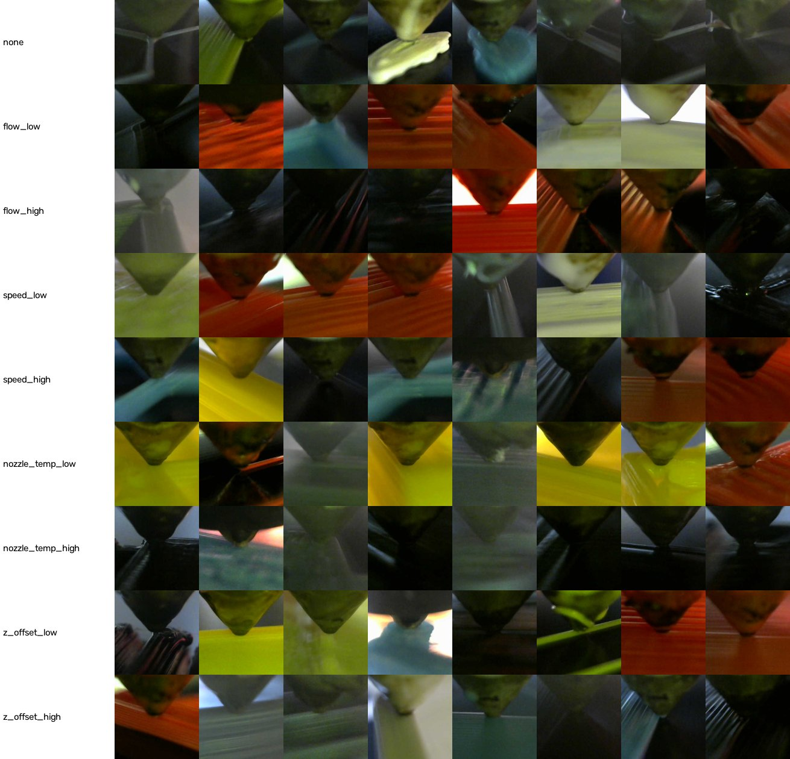

Diagnosis: no pipeline bug found; the cause signal is real but weak across prints (balanced accuracy 0.21 vs 0.11 chance), and the majority floor is high because z_offset_high dominates single-cause images.

# Cause-model diagnostics after T-0012 (2026-11-11)

**Why:** T-0012 fold 0 scored test top-1 0.297 (probe) / 0.249 (fine-tune) against a majority floor of 0.514
(reports/cause_fold0.md). Before spending the 3 h T-0013 run we checked for a pipeline fault.

**Method (dev laptop, CPU):** fold 0 of data/splits/logo.json (sha256 ff6764d9…, the one T-0012 used). Only fold-0
**train** prints (108 prints, up to 30 non-multi images each, 3,100 images) and **calib** prints (27 prints, up to 40 each, 1,051
images); the fold's test prints were never read. Images fetched with scripts/fetch_caxton_subset.py, cropped with
scripts/build_crops.py (same ROI as training). Features = frozen ImageNet ResNet18 (the T-0012 probe backbone); a
linear soft-max probe trained on train prints, scored on calib prints. "Lag" = seconds since the last change of any
setpoint class, computed on the full label CSV (21,305 segments, median segment 12.6 s).

## Crops

8 random training crops per cause (CAXTON, Brion & Pattinson 2022, CC BY 4.0). The nozzle tip is centred and the
deposited line is visible in every crop: **the ROI is correct.** Filament colour and lighting vary per print.

## Results (calib prints)

| experiment | top-1 | balanced acc |
|---|---|---|
| majority floor (z_offset_high) | 0.178 | 0.111 |
| probe, class-weighted CE (as T-0012) | 0.374 | 0.211 |
| probe, plain CE | 0.373 | 0.196 |
| probe, train without images < 3 s after a change | 0.386 | 0.227 |
| probe, train without images < 6 s after a change | 0.386 | 0.224 |
| probe, train without images < 10 s after a change | 0.353 | 0.182 |
| probe on **grayscale** crops | 0.328 | 0.207 |
| **leaky control:** random image split inside the train prints | 0.495 | 0.430 |

Top-1 on calib images by lag since the last change (class-weighted probe): 0–2 s 0.374 · 2–5 s 0.482 · 5–10 s 0.415 ·
10–20 s 0.444 · > 20 s 0.262.

Recall per cause (class-weighted probe): none 0.67, z_offset_high 0.30, speed_low 0.31, flow_high 0.24, others
≤ 0.11 (confusion matrix in the run log).

## What this rules in and out

1. **Not a crop bug.** The sheet shows the right region.
2. **Label lag is minor.** Dropping images just after a change gains ≤ 1.2 pp top-1 / 1.6 pp balanced.
3. **Not a colour shortcut.** Grayscale input gives the same balanced accuracy (0.207 vs 0.211).
4. **Class weighting does not explain the gap.** Plain CE gives the same top-1.
5. **Cross-print generalisation is the core difficulty.** The same probe reaches balanced 0.43 when train and test
   share prints, but 0.21 on new prints: per-print appearance (geometry, layer texture, lighting) dominates. This is
   also why CAXTON's random-image split (ADR-0009) reports much higher accuracy.
6. **The floor is fold-dependent and high.** z_offset_high is the largest single-cause class (9,922 of the 39,231 non-multi images),
   so fold floors range 0.51–0.77 (reports/cause_floor.md) while this calib sample's floor is 0.18. "top-1 ≥ floor
   + 10 pp" asks for 0.61–0.87 top-1 on folds dominated by z_offset_high.

## Consequence

T-0013 (the K2 check, 07 §9, charter) runs as specified; K2 is likely to fire. eval_cause.py now also prints the
balanced accuracy next to the per-class recall (report only, not used by K2). If K2 fires, the decision (pivot per
ADR-0002 option 1, or a DESCEND on the model/metric) belongs to the user; it is not taken here.
